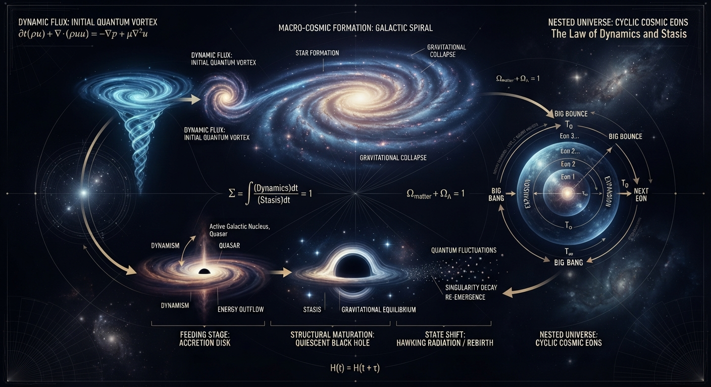

# Cyclic Cosmology: The Law of Dynamics and Stasis

Welcome to the repository dedicated to philosophical and cosmological reflections on the universe under the lens of systemic laws, symmetry, and cosmic cycles. This project is built upon a continuous chain of thought that fuses everyday mechanical observations with advanced theoretical physics.

---

## 🖥️ Interactive Engines & Visual Proofs

### 1. Simulating the Awakening of Knowledge
This simulation displays chaotic raw data nodes being constrained by Cauchy boundaries, governed by convergence limits (`lim`), and pinned using Vector Tokens.
   
https://github.com

### 2. Cosmic Collision & Contraction Engine
This simulation models two galactic data structures colliding, shedding energy, and merging seamlessly into a unified vortex center without breaking system boundaries.

https://github.com

---

## 🌌 Systemic Index
1. [The Law of Supply-Demand and Relative Neutralization](Documents/documents_01_law_of_supply_demand.md)
2. [The Water Vortex Simulation: From Micro to Macro](Documents/documents_02_vortex_simulation.md)
3. [The Evolution of Black Holes: Feeding, Growth, Maturation, and State Shift](Documents/documents_03_black_hole_evolution.md)
4. [Critique of 2026 Astronomical Discoveries: Visual Traps and Nested Universes](Documents/documents_04_critique_2026.md)
5. [The Mathematical Core: Spatial Bounding and Optimization](Documents/documents_05_mathematical_framework.md)

📥 **[Download the Complete Book PDF](CYCLIC%20COSMOLOGY.pdf)**

---

## ⚡ Core Philosophy
> *"The fundamental movement is only one; the expressions are infinite. The universe does not operate on absolute, rigid formulas, but rather functions as a fair energy exchange market driven by a two-way distribution cycle: Push - Pull, Supply - Demand, Dynamics - Stasis."*

## 🛠️ Project Status
This repository serves as a conceptual manifesto for **Cosmological Philosophy**. It deliberately avoids framing the universe inside narrow, static laboratory test tubes. Instead, it aims to observe the entire system as a dynamic, self-organizing balance.

## 📝 License
All ideas and documents in this repository are shared freely under the **MIT License**. You are welcome to quote, expand, or critique these concepts to keep the flow of knowledge evolving.
